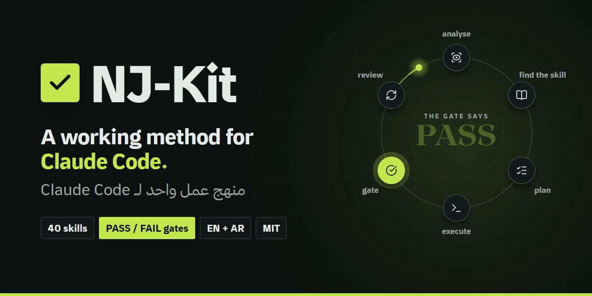
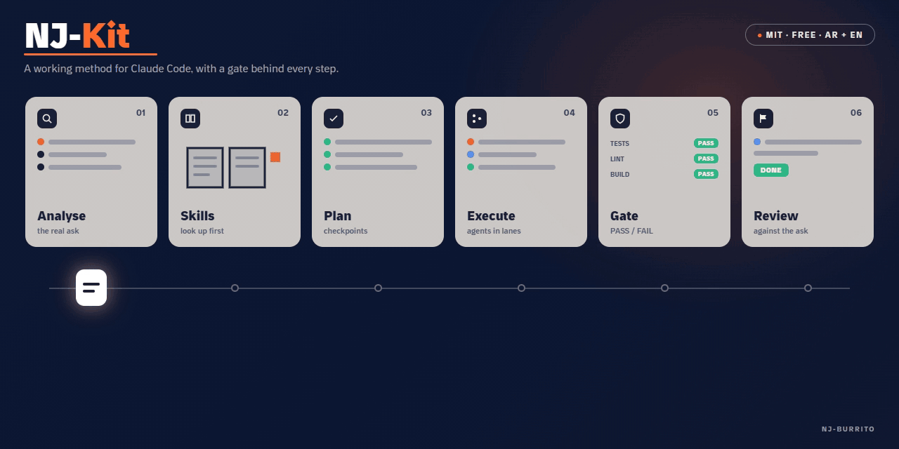

<div align="center">

<a href="https://nj-burrito.github.io/NJ-Kit/"></a>

# NJ-Kit: Claude Code skills that end in PASS or FAIL

### ✅ One working method and 49 skills for Claude Code. Every skill ends in a script that checks the work.

**NJ-Kit by [Nader Alzghoul](https://nj-burrito.github.io/) (NJ-Burrito)**: free, open-source Claude Code skills and plugin, in Arabic and English. [Website](https://nj-burrito.github.io/NJ-Kit/) · [LinkedIn](https://www.linkedin.com/in/nader-alzghoul)

[](https://nj-burrito.github.io/NJ-Kit/)
[](https://github.com/NJ-Burrito/NJ-Kit/actions/workflows/ci.yml)
[](LICENSE)
[](#whats-inside)

<details>
<summary>🏷️ More badges</summary>

[](.claude-plugin/marketplace.json)
[](nj-plugin/skills/nj-proofread)
[](nj-kit/scripts/install.py)
[](https://github.com/NJ-Burrito/NJ-Kit/stargazers)

</details>

</div>

> ### ⚡ In 10 seconds
> 🧠 **What:** a free method and 49 skills for Claude Code.\
> ✅ **Why:** a script prints **PASS** or **FAIL**. No "should work".\
> 🚀 **Start:** paste 2 lines into Claude Code. [Go ↓](#plugin)\
> 🌐 **Website:** [nj-burrito.github.io/NJ-Kit](https://nj-burrito.github.io/NJ-Kit/) · [بالعربية](https://nj-burrito.github.io/NJ-Kit/ar/)

🧭 **Jump to:** [Start here](#start-here) · [How it works](#how) · [What's new](#new) · [Skills](#whats-inside) · [PASS/FAIL](#gates) · [NJ-Narration](#narration) · [Compare](#compare) · [Safety](#safe) · [Questions](#faq) · [Credits](#credits) · [Contribute](#contribute) · [NJ-Font](#nj-font) · [العربية](#ar)

---

<a id="start-here"></a>

## 🚦 Start here · pick one row

| You want… | Take this | Time |
|---|---|---|
| 🧩 Claude Code, fastest | [Plugin ↓](#plugin) · 30 skills | ⏱️ 1 min |
| 🧰 All 45 on a new machine | [Kit installer ↓](#kit) | ⏱️ 5 min |
| 📂 Another agent that reads `SKILL.md` | [Copy one skill ↓](#whats-inside) | ⏱️ 1 folder |
| 🔤 The typeface | [NJ-Font ↓](#nj-font) (coming soon) | ⏱️ soon |

All free. 👆 Pick one and skip the rest.

---

<a id="how"></a>

## 🔁 How it works · 6 steps, 1 gate

<div align="center"></div>

| Step | What happens |
|---|---|
| 🔍 **1 Analyse** | Name the deliverable and what "done" means |
| 📖 **2 Find the skill** | Use a tested skill before improvising |
| 📋 **3 Plan** | Short steps, each leaving a checkpoint file |
| ⌨️ **4 Execute** | Do the work, checking as it goes |
| ✅ **5 Gate** | A script prints PASS or FAIL. FAIL: one fix, run again |
| 🔄 **6 Review** | Compare the result with the request, item by item |

---

<a id="plugin"></a>

## 🧩 Plugin · ⏱️ 1 minute

**1.** In Claude Code, paste:

```
/plugin marketplace add NJ-Burrito/NJ-Kit
/plugin install nj-kit@nj-kit
```

**2.** Say: **"use nj-method"** ✅ Done. You have 30 skills.

---

<a id="kit"></a>

## 🧰 Kit installer · ⏱️ 5 minutes

Needs: 🐍 Python 3.10+

```bash
git clone https://github.com/NJ-Burrito/NJ-Kit
cd NJ-Kit
python nj-kit/scripts/install.py --check       # 👀 preview, changes nothing
python nj-kit/scripts/install.py               # ✅ install
python nj-kit/scripts/fetch_assets.py --all    # 📦 download NJ-Kit assets v1
```

<details>
<summary>📖 More: where skills go, the assets, options</summary>

- 📍 Skills land in `~/.claude/skills/` (every repo on this machine).
- 🎯 `--scope project` puts them in one repo instead.
- 📦 **NJ-Kit assets v1** is a GitHub release (tag `assets-v1`).
- It holds the heavy parts kept out of git:
  - the graphify package (used by `nj-codebase-graph`)
  - the nj-researcher source registry
  - the tashkeel evidence runs
- 🔐 `fetch_assets.py` checks each file's sha256 before writing it.
- 📋 `--list` shows them.
- ⚡ [uv](https://docs.astral.sh/uv/) is recommended for Python.
- 📖 Full guide: [nj-kit/README.md](nj-kit/README.md)

</details>

---

<a id="new"></a>

## 🆕 What's new in 3.1.2

Release: [v3.1.2 on GitHub](https://github.com/NJ-Burrito/NJ-Kit/releases/tag/v3.1.2).

- 🟢 **Halo on NJ-QA windows only:** `nj-agent-halo` now draws its border only on browser windows the NJ-QA tool opens; every other window, agent or not, stays plain, and the keeper stops after 2 minutes when no NJ-QA window appears.

## 🆕 What's new in 3.1.1

Release: [v3.1.1 on GitHub](https://github.com/NJ-Burrito/NJ-Kit/releases/tag/v3.1.1).

- 🗂️ **The kit knows its categories:** `nj-kit/manifest.json` carries a `categories` block and a `category` on every skill entry, and `nj-kit/SKILL.md` states the naming rule: every new skill gets an `nj-<what it does>` name and a purpose category in the same change.

## 🆕 What's new in 3.1.0

Release: [v3.1.0 on GitHub](https://github.com/NJ-Burrito/NJ-Kit/releases/tag/v3.1.0). 30 plugin skills, 49 with the kit installer.

- 🎛️ **New skill `nj-ui-motion-laws`:** the 20 laws of UI motion and UX (Disney's principles applied to interfaces, plus Fitts, Hick, Miller, Doherty, Postel, Jakob and frequency of use), each with a rule, a before and after, and a check with a number. `scripts/motion_lint.py` is the gate: it fails durations over 300 ms, `linear` easing, `transition: all`, and motion with no `prefers-reduced-motion` rule (11-case self-test). Built from Charles Liu's reel "20 Principles of UX & Animation" and the works it credits; see `NOTICE.md`.

## 🆕 What's new in 3.0.0

Release: [v3.0.0 on GitHub](https://github.com/NJ-Burrito/NJ-Kit/releases/tag/v3.0.0). 29 plugin skills, 48 with the kit installer.

- 🏷️ **Every skill this repo ships is now named `nj-<what it does>`** and sits in a purpose group (the README table and the website are grouped). Renamed: `devil` → `nj-devil`, `session-handoff` → `nj-handoff`, `agent-halo` → `nj-agent-halo`, `pdf-typography` → `nj-pdf-typography`, `arabic-english-proofreading` → `nj-proofread`, `workflow-diagram` → `nj-workflow-diagram`, `impact-copy` → `nj-impact-copy`, `voice-clean` → `nj-voice-clean`, `bg-music` → `nj-music`, `website-fine-print` → `nj-site-audit`; in the kit: `srs-verifier` → `nj-doc-verifier`, `safe-delete` → `nj-safe-delete`, `general-video` → `nj-video`, `graphify` → `nj-codebase-graph`, and the design skills to `nj-taste-frontend`, `nj-premium-design`, `nj-minimalist-ui`, `nj-redesign`, `nj-brandkit`, `nj-hyperframes-studio`. **Breaking:** say the new names. Third-party skills the installer fetches keep their upstream names.
- 🎬 **New skill `nj-animation-direction`:** directs animation before anyone animates it: a beat sheet whose pressure adds up, blocking in numbers, character-acting briefs (objective, action, obstacle, the thought before, the end state), a gated animatic built from stills and scratch sound, review checklists, and hand-off rules for GSAP/HyperFrames, Rive state machines, Theatre.js and Remotion. Built on a 312-entry knowledge base researched in four parallel lanes; `shotlist.py` gate with a 21-assertion self-test.
- 🧶 **Kit gains `nj-untangle-codebase`** (from caldoai/skills, MIT): one-pass restructuring of a tangled codebase.
- 🧹 Cleanup: unused imports, empty f-strings, unused variables and one dead statement removed across the Python.

## What was new in 2.4.4

Release: [v2.4.4 on GitHub](https://github.com/NJ-Burrito/NJ-Kit/releases/tag/v2.4.4). 28 plugin skills.

- **New skill `nj-listen`:** gives Claude ears. A meeting recording (audio or video, multitrack, minutes to hours) becomes a timed, speaker-labelled transcript, locally, free and open source, with no cloud call. Built for Arabic dialects with English words mid-sentence: Whisper large-v3-turbo on the Intel iGPU through OpenVINO, sherpa-onnx speakers, names from each attendee's self-introduction. Measured on a laptop with no graphics card: 49.8 minutes of audio in 18.8 minutes.

## What was new in 2.4.3

Release: [v2.4.3 on GitHub](https://github.com/NJ-Burrito/NJ-Kit/releases/tag/v2.4.3). 27 plugin skills, 45 with the kit installer.

- 🧹 Dead-code sweep: Knip on the JS/TS, vulture on the Python; a stray PDF named `--help` removed from `nj-pdf-typography`; details in the changelog.

## 🆕 What's new in 2.4.2

Release: [v2.4.2 on GitHub](https://github.com/NJ-Burrito/NJ-Kit/releases/tag/v2.4.2). 27 plugin skills, 45 with the kit installer.

- 🧭 `nj-method` and `nj-kit` describe the plain working mode: the session does the work; subagents only for real parallel work.
- 🧹 Knip scan of all JS/TS: no unused files or dependencies; details in the changelog.

## 🆕 What's new in 2.4.1

Release: [v2.4.1 on GitHub](https://github.com/NJ-Burrito/NJ-Kit/releases/tag/v2.4.1). 27 plugin skills, 45 with the kit installer.

- 🧭 `nj-method` routes commercials, promos, launch and brand films to `nj-multimedia`.

## 🆕 What's new in 2.4.0

Release: [v2.4.0 on GitHub](https://github.com/NJ-Burrito/NJ-Kit/releases/tag/v2.4.0). 27 plugin skills, 45 with the kit installer.

- 🎬 New kit skill `nj-multimedia`: commercials made the way an agency makes them. A creative crew and a marketing crew work in parallel, a director merges them into one storyboard, a devil pass attacks it, the owner approves once on the proposal plus keyframe boards, then sound and motion crews build in parallel and machine gates check the result before one render per deliverable. Motion graphics only, story before features, every claim sourced. Scripts: `mm.py` (stage gates, a pre-voice fit check, a render probe with loudness and language-pair parity, contact sheets) and `frame_probe.mjs` (1 px axis alignment, the fonts Chrome really rendered, Arabic on-screen text rules); both self-tested.

## 🆕 What's new in 2.3.3

Release: [v2.3.3 on GitHub](https://github.com/NJ-Burrito/NJ-Kit/releases/tag/v2.3.3). Still 27 plugin skills, 44 with the kit installer.

- 🗣️ `nj-writer` voice gate: a product name listed under `latin_brands` in `voice-styles.json` stays Latin in the Arabic TTS text and is said exactly as in English; the gate no longer asks to spell it out. Unlisted Latin words still fail.

## What's new in 2.3.2

Release: [v2.3.2 on GitHub](https://github.com/NJ-Burrito/NJ-Kit/releases/tag/v2.3.2). Still 27 plugin skills, 44 with the kit installer.

- 🏷️ `nj-jira` bug template: the evidence rules now name the Arabic file-name rule from 2.3.1 and point to `nj-qa/scripts/evidence_name.py`.
- 🧪 `nj-qa` self-check: `test_nj_qa.py` now covers the evidence-name rules, including the refusals in `report-check` and `preview-check`.

## 🆕 What's new in 2.3.1

Release: [v2.3.1 on GitHub](https://github.com/NJ-Burrito/NJ-Kit/releases/tag/v2.3.1). Still 27 plugin skills, 44 with the kit installer.

- 🏷️ **Evidence names are Arabic** in `nj-qa` and `nj-jira`: `<المشكلة>-<الخدمة>-<التاريخ>-<الوقت>`, time as `HH.MM`. `nj-qa/scripts/evidence_name.py` makes the name, and `report-check` and `preview-check` refuse any other picture or video name. Existing runs keep their names (`NJQA_LEGACY_EVIDENCE=1`).
- 🧪 `nj-qa`: a blocked or untestable note can carry a `block_cause` (`data`, `system` or `tool`), and the checks refuse any other value.
- 🌐 **The website's skill list is generated** from the plugin's `SKILL.md` files, and CI fails when the committed site is stale.

## 🆕 What's new in 2.3.0

Release: [v2.3.0 on GitHub](https://github.com/NJ-Burrito/NJ-Kit/releases/tag/v2.3.0).

| Skill | What it adds |
|---|---|
| 📊 [nj-chart](nj-plugin/skills/nj-chart) | Charts, dashboards and KPI rows that read at a glance, in Arabic or English, light or dark. Built on [Flint](https://github.com/microsoft/flint-chart) by Microsoft (MIT) |
| 🧪 [nj-qa](nj-plugin/skills/nj-qa) | A crew of agents tests a service's Jira notes on the live system: one leader per service, a tester per route, scavengers for defects nobody listed. Scripts enforce the limits (`nj_qa.py`) |
| 🟠 [nj-agent-halo](nj-plugin/skills/nj-agent-halo) | Every browser window an agent opens gets a coloured border and the agent's name, so you can tell windows apart. Screenshots and page text never see it |

Also: `scripts/publish-check.py`, the gate every release now passes before it is pushed (no credentials, no private project data, no machine paths, no font files). Full list: [CHANGELOG.md](CHANGELOG.md).

---

<a id="whats-inside"></a>

## 📦 45 Claude Code skills · tap a row to open

27 come with the plugin. The kit installer adds 18. Every one ends in a PASS or FAIL gate.

<details open>
<summary>🧩 <b>In the plugin</b> · 30 skills · generated from each <code>SKILL.md</code></summary>

<!-- skills:start -->

**Method and agents**

| Skill | What it does |
|---|---|
| [nj-method](nj-plugin/skills/nj-method) | Nader's default method for every request: analyse the ask, look up installed skills before improvising, plan with named checkpoints, execute, review against what was asked |
| [nj-delegate](nj-plugin/skills/nj-delegate) | NJ Governance v4: the Lead (Opus) administers and decides, Sonnet leads build in their own worktrees, Haiku helpers do bounded mechanical work (depth 2, at most 20 agents counted, helpers required by the ITEMS rule) |
| [nj-agent-ops](nj-plugin/skills/nj-agent-ops) | NJ Governance v4 (v3 briefs still accepted) transport under nj-delegate: telemetry refused at write time (relay.py), path claims that enforce single-writer, KPI audit via verify, results through files, one wake per batch, a low-effort interpreter spawned on a trigger |
| [nj-supervise](nj-plugin/skills/nj-supervise) | How to brief a delegated worker and how to know it is actually working |
| [nj-handoff](nj-plugin/skills/nj-handoff) | Close a session by writing a handoff.md the next session reads first, instead of dragging degraded context through /compact |
| [nj-learn](nj-plugin/skills/nj-learn) | Capture a lesson the moment work teaches one and write it where it will be read: the owning skill, CLAUDE.md, memory, or the nj-kit manifest |
| [nj-wrapup](nj-plugin/skills/nj-wrapup) | Close a work session or a tested service end to end: discover what already exists, classify results through gates, file Bugs and Tasks with evidence (clean rows only, risky rows held), reconcile every count against Jira, register the work in nj-rank, and render the boss email (Arabic + English) and the QA-team message from the reconciled trace |
| [nj-devil](nj-plugin/skills/nj-devil) | Adversarial critique of a plan, design, architecture or vendor choice before it is acted on: ranked objections, the assumption each attacks, the cheapest settling test |
| [nj-security-review](nj-plugin/skills/nj-security-review) | Review third-party skills, plugins and MCP servers for prompt injection, concealment, permission bypass, self-installing hooks, credential access, exfiltration, obfuscation |
| [nj-agent-halo](nj-plugin/skills/nj-agent-halo) | Every browser window an agent opens carries a coloured border and the agent's type at the top, so a person can tell agent windows apart |

**QA and Jira**

| Skill | What it does |
|---|---|
| [nj-jira](nj-plugin/skills/nj-jira) | Open the owner's Jira, analyse a ticket into a report and an automation, file Bugs with evidence (screenshots, related Story, assignee), QA re-check our Bugs (verify -> comment + Done, or Re Opened) and keep the tracker |
| [nj-jira-to-automation](nj-plugin/skills/nj-jira-to-automation) | Turn a Jira ticket (or a service's open Bugs) into a runnable automation: analyse into notes, check each on the portal, write one standalone test per note (jiraCheck / jiraSkipped / noteEnv), mark filed-request notes blocked, resume on a ticket, run once |
| [nj-qa-pipeline](nj-plugin/skills/nj-qa-pipeline) | End-to-end QA pipeline that combines the Jira skills: Jira -> notes -> staging check -> acceptance report -> automation -> full route walks (one agent per service, extra agents per route share) -> Bug filing -> QA re-check -> tracker -> Docker + share + 7z |
| [nj-automation-suite](nj-plugin/skills/nj-automation-suite) | Create an automation-tests folder (a portable, self-contained Playwright suite): layout, lib/paths.ts portability (env vars, auto-discovery, no absolute paths), HTML report + per-service Jira HTML, AI-RUN-NOTES.md, AGENT.md, PDFs (Thmanyah TrueType only), launchers, Docker image-only share, sweep-chrome, sign-in lock |
| [nj-rank](nj-plugin/skills/nj-rank) | Register finished work, keep its evidence paths, and file it to Jira as Done Tasks assigned to the user; close the user's own open Tasks |
| [nj-qa](nj-plugin/skills/nj-qa) | NJ-QA: the owner's agent-crew method for testing a service's Jira notes on the live system, with one Opus leader per service, Haiku harvesters, one Sonnet tester per route and Haiku scavengers hunting unlisted defects, ending in a preview he decides on |

**Documents, charts and writing**

| Skill | What it does |
|---|---|
| [nj-pdf-typography](nj-plugin/skills/nj-pdf-typography) | PDFs whose text stays real: selectable and searchable |
| [nj-proofread](nj-plugin/skills/nj-proofread) | Proofread Arabic, English or bilingual text (SRS, official submissions, manuals, UI strings) |
| [nj-workflow-diagram](nj-plugin/skills/nj-workflow-diagram) | Draw or fix an SRS workflow figure «مخطط سير العمل» from evidence: one box per element the model walks, left-to-right, an «إجراء» decision after any multi-exit task |
| [nj-writer](nj-plugin/skills/nj-writer) | Writes narration and script words: commercials, e-learning, walkthroughs, podcasts, event/recruitment/investor pieces, Arabic or English |
| [nj-impact-copy](nj-plugin/skills/nj-impact-copy) | House style since 17 Sept 2026: impact-first, metric-driven copy for commercials, captions, brag docs, release notes |
| [nj-site-audit](nj-plugin/skills/nj-site-audit) | Pre-ship site audit: privacy exposure, hygiene (broken links, overflow, favicon, titles, 404, copyright year), policy claims versus third parties contacted, page-observable security |
| [nj-chart](nj-plugin/skills/nj-chart) | Charts, dashboards and metric reports that read at a glance, in Arabic or English, light or dark, built on the Flint chart engine (MCP server `flint`) |

**Audio, video and animation**

| Skill | What it does |
|---|---|
| [nj-listen](nj-plugin/skills/nj-listen) | Give Claude ears: turn a meeting recording (audio or video, multitrack, minutes to hours) into who said what and when, locally, free and open source, no cloud |
| [nj-voice-clean](nj-plugin/skills/nj-voice-clean) | Clean and master spoken voice (voiceover, narration, podcast, reel) to broadcast loudness with ffmpeg only: the Premiere chain EQ, DeEsser, DeNoise, Compressor, Amplify, Limiter in one command |
| [nj-narration](nj-plugin/skills/nj-narration) | Cast and engineer a TTS voice for any story: casting brief from the character, licensed sources, signal-only rubric, top 3 for the ear; direction sheet, pronunciation lexicon, reference prep, commissioned-talent consent; engine, caps, one take; edge clean, mastering chain, loudness, gates, healing |
| [nj-music](nj-plugin/skills/nj-music) | Holds a bundled licence-cleared CC0 SFX library and music beds with cue presets, and sources from Openverse, Jamendo, Freesound, ccMixter, Wikimedia with licence, credit line and retrieval date per track |
| [nj-director](nj-plugin/skills/nj-director) | Film direction (not agent delegation — see nj-delegate for that) |
| [nj-animation-direction](nj-plugin/skills/nj-animation-direction) | Direct animation before anyone animates it: beat sheet with pressure arithmetic, blocking in numbers, shot list with character-acting briefs (objective, action, obstacle, thinking beat, end state), a gated animatic built from stills and scratch sound, review checklists, then hand-off rules for GSAP/HyperFrames, Rive state machines, Theatre.js and Remotion |
| [nj-ui-motion-laws](nj-plugin/skills/nj-ui-motion-laws) | The 20 laws of UI motion and UX (Disney's animation principles applied to interfaces, plus Fitts, Hick, Miller, Doherty, Postel, Jakob and frequency of use) as build rules with numbers, a before/after for each, and motion_lint.py that fails slow, linear or unguarded CSS motion |

<!-- skills:end -->

</details>

<details>
<summary>🧰 <b>Bundled with the kit</b> · 19 more · research, design, decks, code</summary>

| Group | Skills |
|---|---|
| 🔬 By NJ · 10 | nj-evidence · nj-knowledge-book · nj-researcher · nj-style-film · nj-multimedia · nj-motion-deck · nj-laya · nj-pinterest · nj-doc-verifier · nj-safe-delete |
| 🎨 Third-party design · 7 | nj-brandkit · nj-taste-frontend · nj-premium-design · nj-minimalist-ui · nj-redesign · nj-hyperframes-studio · nj-video |
| 🕸️ Third-party code · 2 | nj-codebase-graph (graphify) · nj-untangle-codebase |

- 🧰 The kit installer puts them in place.
- 📦 Heavy parts come from **NJ-Kit assets v1**: `python nj-kit/scripts/fetch_assets.py --all`
- 📁 Folder: [`nj-kit/bundled`](nj-kit/bundled) · 🙏 Credits: [THIRD_PARTY.md](THIRD_PARTY.md)

</details>

---

<a id="compare"></a>

## 🆚 NJ-Kit and other Claude Code skill collections

You can combine them. NJ-Kit skills are plain `SKILL.md` folders, so they work next to skills from any of these.

| Project | What it is | Reach for it when |
|---|---|---|
| ✅ **NJ-Kit** | A working method and 49 skills. Every skill ends in a PASS or FAIL script. Arabic and English | You want the agent to prove a task is done |
| [anthropics/skills](https://github.com/anthropics/skills) | Anthropic's public repository for Agent Skills | You want the skills Anthropic publishes itself |
| [obra/superpowers](https://github.com/obra/superpowers) | An agentic skills framework and software development methodology | You want a software development methodology built from skills |
| [awesome-claude-code](https://github.com/hesreallyhim/awesome-claude-code) | A hand-picked list of Claude Code resources: skills, agents, plugins, tools | You want to browse what exists |

Descriptions from each project's own GitHub page, 24 Oct 2026.

---

<a id="nj-font"></a>

## 🔤 NJ-Font

A typeface by Nader Alzghoul. **Coming soon:** the font files are not published yet, so `NJ-Font/` holds only a README. The commands below are what will work once they land.

<details>
<summary>🍎 macOS / 🐧 Linux</summary>

```bash
git clone https://github.com/NJ-Burrito/NJ-Kit
cd NJ-Kit
cp NJ-Font/ttf/*.ttf ~/Library/Fonts/                                                  # macOS
mkdir -p ~/.local/share/fonts && cp NJ-Font/ttf/*.ttf ~/.local/share/fonts/ && fc-cache -f   # Linux
```

</details>

<details>
<summary>🪟 Windows (no admin needed)</summary>

```powershell
git clone https://github.com/NJ-Burrito/NJ-Kit
cd NJ-Kit
$dir = "$env:LOCALAPPDATA\Microsoft\Windows\Fonts"; New-Item -ItemType Directory -Force $dir | Out-Null
Get-ChildItem NJ-Font\ttf\*.ttf | ForEach-Object {
  Copy-Item $_ $dir
  New-ItemProperty "HKCU:\Software\Microsoft\Windows NT\CurrentVersion\Fonts" -Name "$($_.BaseName) (TrueType)" -Value "$dir\$($_.Name)" -Force | Out-Null
}
```

</details>

<details>
<summary>🌐 Web</summary>

```css
@font-face { font-family: "NJ-Font"; src: url("NJ-Font/woff2/NJ-Font-Regular.woff2") format("woff2"); font-display: swap; }
```

</details>

- 📁 Fonts land in your user font folder.
- 🔄 Restart open apps to see them.
- 📖 More: [NJ-Font/README.md](NJ-Font/README.md)

---

<a id="safe"></a>

## 🔒 Is it safe?

| | |
|---|---|
| 🔑 **No secrets** | Keys and URLs come from your environment or `~/.claude/secrets/` |
| 🗑️ **Safe deletes** | To the recycle bin, never `rm -rf` |
| 🧪 **Real gates** | A skill can't say PASS unless the check ran |
| 🛡️ **Guard hook** | Sub-agents can't read secret paths |

---

<a id="faq"></a>

## ❓ Questions about NJ-Kit and Claude Code skills · tap to open

<details><summary>🧠 What is NJ-Kit?</summary>

A free, open-source Claude Code plugin: one working method and 49 skills. Every skill ends in a script gate that prints PASS or FAIL. MIT licence, by Nader Alzghoul.
</details>

<details><summary>📂 What are Claude Code skills?</summary>

A skill is a folder with a `SKILL.md` file of instructions, plus any scripts it needs. Claude Code reads each skill's description and loads the skill when a task matches it.
</details>

<details><summary>✅ What is a gate?</summary>

A script at the end of a skill that checks the result and prints PASS or FAIL. On FAIL, the skill makes one fix and runs the gate again.
</details>

<details><summary>🆚 How is it different from Anthropic's skills repository?</summary>

Anthropic's repository is its public collection of Agent Skills. NJ-Kit is an independent kit built around one working method, and every one of its skills ends in a PASS or FAIL script. You can install both. [Compare ↑](#compare)
</details>

<details><summary>🤖 Does it work with agents other than Claude Code?</summary>

Any agent that reads `SKILL.md` files can use the skill folders directly, with no installer. The plugin route is for Claude Code.
</details>

<details><summary>🏢 Is NJ-Kit made by Anthropic?</summary>

No. An independent project by Nader Alzghoul, not affiliated with or endorsed by Anthropic.
</details>

<details><summary>💸 Is it free?</summary>

Yes. MIT licence.
</details>

<details><summary>📂 Do I need all of it?</summary>

No. Copy one skill folder into `~/.claude/skills/` and it works on its own.
</details>

<details><summary>🌍 Arabic?</summary>

Yes. Arabic and English are both first-class, RTL included.
</details>

<details><summary>🗺️ Will paths work on my machine?</summary>

Yes. Nothing is tied to one machine.

- ⚙️ Set the variables a skill names: `NJ_PLUGIN_ROOT`, `JIRA_BASE_URL`, `PORTAL_URL`…
- 🏠 Or keep the defaults under your home folder.
</details>

---

<a id="narration"></a>

## 🎙️ NJ-Narration · the right voice, no noise around it

> **In the plugin since 2.0.2.** A skill that picks and cleans a narrator's voice, and prints PASS or FAIL for every step.

- 🎯 **Scout a voice that fits the character.** Describe age, origin, accent and mood; the skill turns it into numbers and measures licensed voices against them.
- 🛠️ **Engineer it once, at the source.** The reference clip is cleaned once and every line is voiced once. No re-voicing until one sounds right.
- 🩹 **Heal noise without cutting words.** Hiss before or after a sentence is removed, and a gate checks the speech itself is untouched.
- 🎬 **Direct it before it speaks.** A direction sheet per character, a pronunciation lexicon, and consent and recording templates for hired voice actors. A child's voice is never cloned.
- 🔎 **Describe a source voice by numbers.** A CPU-only script reports pitch, formants, dialect and quality with a basis and a confidence on every line, never claims to have listened, and can block a clip that sounds like a child. It never judges a finished take.

**One example** (made-up data, to show the shape of the output; not a real measurement, not a real person):

```text
BRIEF    narrator, woman, 40 to 55, calm, British English, dry room
TARGET   pitch 165 to 210 Hz, 130 to 150 words a minute, little echo
SOURCES  public domain or written consent only, one clip per speaker

REFERENCE CLIP (the one you will clone)
REF-QUALITY       FAIL  0.6 s of room tone at the start
                  # cleaned once, word-safe, then measured again
REF-QUALITY       PASS

EACH GENERATED LINE (one take)
TAKE-QUALITY      PASS
VOICE-EDGE-NOISE  FAIL  1.9 s of hiss after the last word
                  # cleaned without touching the speech
VOICE-EDGE-NOISE  PASS  speech samples identical

NEXT     the top 3 voices go to your ear. You decide.
```

**Install:** the same two lines as NJ-Kit ([Plugin ↑](#plugin)). `nj-narration` is one of the 30 plugin skills; after installing, say **"use nj-narration"**.

Plugin only: `/plugin install nj-kit@nj-kit`. Any other agent that reads `SKILL.md`: copy the folder [`nj-plugin/skills/nj-narration`](nj-plugin/skills/nj-narration).

**Honest note:** NJ-Narration ships no voices and no audio samples. It includes no voice engine and picks none for you: you bring a licensed voice and an engine you are allowed to use. The numbers decide what reaches your ear; your ear decides last.

---

<a id="gates"></a>

## ✅ The PASS/FAIL convention

Every skill ends in a gate: a script that checks the result instead of trusting it.

- 🖨️ The last line it prints is **`PASS`** or **`FAIL`**, and the exit code matches (0 or 1).
- 📍 A FAIL names what failed: the file, the line, the rule. It never prints a secret it found.
- 🔁 On FAIL: one fix, then run the gate again. No "should work".
- 🧪 Most scripts carry a `--selftest` that proves each FAIL path still fires.

This repo follows it too: `python scripts/publish-check.py` before every push, `python scripts/skill-table.py --check` for this README. CI runs both.

---

<a id="credits"></a>

## 🙏 Credits and licences

- 📜 NJ-Kit is [MIT](LICENSE).
- 📊 `nj-chart` drives [Flint](https://github.com/microsoft/flint-chart) by Microsoft Corporation (MIT). It adds rules and wiring and does not copy Flint's code.
- 🎨 Bundled third-party skills and vendored libraries keep their own licences: [THIRD_PARTY.md](THIRD_PARTY.md).
- 🔤 No font files ship here. Skills that name a typeface load it from your machine and fall back to a system font.

---

<a id="contribute"></a>

## 🤝 Contribute

1. 📁 One skill per folder, with a `SKILL.md` (`name` and `description` in the frontmatter).
2. ✅ End it in a gate that prints PASS or FAIL.
3. 🔐 No secrets, no client or project data, no absolute paths: read them from environment variables or `~/.claude/secrets/`.
4. 🧪 Run `python scripts/publish-check.py` and `python scripts/skill-table.py` before you open a pull request.

Details: [CONTRIBUTING.md](CONTRIBUTING.md).

---

## 🔗 More from NJ

| | |
|---|---|
| 👤 [**Portfolio**](https://nj-burrito.github.io/) | Nader's work |
| 🧪 [**QA Wrap**](https://nj-burrito.github.io/QA-Wrap/) | Test the page, get the bug report. [Source](https://github.com/NJ-Burrito/QA-Wrap) |
| 📄 [**Business-Wrap**](https://nj-burrito.github.io/Business-Wrap/) | Evidence in, one document in two languages. [Source](https://github.com/NJ-Burrito/Business-Wrap) |
| 🧾 [**Profile-Wrap**](https://nj-burrito.github.io/Profile-Wrap/) | Your LinkedIn on autopilot, you stay the boss. [Source](https://github.com/NJ-Burrito/Profile-Wrap) |
| 🎬 [**Story-Wrap**](https://www.instagram.com/nj.story.ar/) | The series «مكتب المفقودات» |
| 🐙 [**GitHub**](https://github.com/NJ-Burrito) · 💼 [**LinkedIn**](https://www.linkedin.com/in/nader-alzghoul) · ✉️ [**Contact**](https://nj-burrito.github.io/#contact) | |
| 🌐 **This kit's website** | [English](https://nj-burrito.github.io/NJ-Kit/) · [Arabic](https://nj-burrito.github.io/NJ-Kit/ar/) |

---

<a id="ar"></a>

## 🌍 بالعربية

<div dir="rtl" lang="ar">

**NJ-Kit** منهج عمل مجاني و49 مهارة لـ Claude Code. تنتهي كل مهارة بسكربت يفحص النتيجة ويطبع PASS أو FAIL، فتعني «تم» أن فحصًا جرى فعلًا.

- 🚀 **ابدأ:** الصق السطرين في Claude Code، فتحصل على 30 مهارة في نحو دقيقة. [السطران ↑](#plugin)
- 🧰 **الحزمة كاملة:** يضيف مثبّت الحزمة الـ19 الباقية. [المثبّت ↑](#kit)
- 📂 **أي وكيل:** يقرأ ملفات `SKILL.md`؟ انسخ مجلد مهارة واحدة، بلا مثبّت.
- 🌍 **العربية والإنجليزية** بالمستوى نفسه، مع دعم الكتابة من اليمين إلى اليسار ومدقق لغوي للنص العربي.
- 🎙️ **NJ-Narration** (ضمن الإضافة، `nj-narration`): مهارة تختار صوت الراوي المناسب للشخصية، وتهندسه مرة واحدة من المصدر، وتعالج الضجيج قبل الجملة وبعدها دون قصّ الكلمات. لا تأتي بأي أصوات ولا بعينات صوتية. [مثال بالنص ↑](#narration)
- 🆕 **جديد في 3.1.2** ([الإصدار v3.1.2 على GitHub](https://github.com/NJ-Burrito/NJ-Kit/releases/tag/v3.1.2)): صار `nj-agent-halo` يرسم الإطار الملوّن على نوافذ أداة NJ-QA فقط، وتبقى كل نافذة أخرى بلا إطار، ويتوقف المراقب بعد دقيقتين إن لم تظهر نافذة من NJ-QA.
- 🆕 **جديد في 3.1.1** ([الإصدار v3.1.1 على GitHub](https://github.com/NJ-Burrito/NJ-Kit/releases/tag/v3.1.1)): يحمل ملف `nj-kit/manifest.json` فئات المهارات حسب الغرض، ويذكر `nj-kit/SKILL.md` قاعدة التسمية: كل مهارة جديدة تأخذ اسم `nj-<ما تفعله>` وفئة في التغيير نفسه.
- 🆕 **جديد في 3.1.0** ([الإصدار v3.1.0 على GitHub](https://github.com/NJ-Burrito/NJ-Kit/releases/tag/v3.1.0)): مهارة جديدة `nj-ui-motion-laws` تجمع عشرين قانونًا لحركة الواجهة وتجربة المستخدم، لكل قانون قاعدة ومثال قبل وبعد وفحص برقم، ويفحص `motion_lint.py` ملفات CSS فيُفشل المدة الأطول من 300 ملي ثانية والحركة الخطية و`transition: all` وغياب قاعدة تقليل الحركة.
- 🆕 **جديد في 3.0.0** ([الإصدار v3.0.0 على GitHub](https://github.com/NJ-Burrito/NJ-Kit/releases/tag/v3.0.0)): كل مهارة يحملها هذا المستودع صار اسمها `nj-<ما تفعله>` وتقع في مجموعة حسب الغرض، والجدول والموقع مجمّعان كذلك. **تغيير غير متوافق:** استعمل الأسماء الجديدة، مثل `devil` ← `nj-devil` و`session-handoff` ← `nj-handoff` و`pdf-typography` ← `nj-pdf-typography`. مهارة جديدة `nj-animation-direction` تُخرج الرسوم المتحركة قبل تحريكها: إيقاع المشاهد، والحركة على المسرح بالأرقام، وتمثيل الشخصيات، وأنيماتيك مضبوط ببوابة، ثم التسليم إلى GSAP أو Rive أو Theatre.js، على قاعدة معرفة من 312 مدخلًا. وتضيف الحزمة `nj-untangle-codebase` لإعادة هيكلة شيفرة متشابكة في تمريرة واحدة. تحتفظ مهارات الأطراف الخارجية التي يجلبها المثبّت بأسمائها الأصلية.
- 🆕 **جديد في 2.4.0** ([الإصدار v2.4.0 على GitHub](https://github.com/NJ-Burrito/NJ-Kit/releases/tag/v2.4.0)): مهارة جديدة في الحزمة `nj-multimedia` لصناعة الإعلانات كما تصنعها وكالة: فريق إبداعي وفريق تسويق بالتوازي، ومخرج يجمع عملهما في لوحة قصة واحدة، وموافقة واحدة من المالك على المقترح ولوحات اللقطات، ثم فريقا الصوت والحركة، وبوابات آلية قبل التصيير.
- 🆕 **جديد في 2.3.3** ([الإصدار v2.3.3 على GitHub](https://github.com/NJ-Burrito/NJ-Kit/releases/tag/v2.3.3)): بوابة الصوت في `nj-writer` تسمح لاسم منتج مسجّل في `latin_brands` أن يبقى بالأحرف اللاتينية في نص التعليق العربي فيُنطق كما هو بالإنجليزية. وفي 2.3.2 ([الإصدار v2.3.2 على GitHub](https://github.com/NJ-Burrito/NJ-Kit/releases/tag/v2.3.2)): قالب البلاغ في `nj-jira` يذكر الآن قاعدة أسماء ملفات الأدلة بالعربية، واختبار `nj-qa` الذاتي يغطي قواعد هذه الأسماء. وفي 2.3.1 ([الإصدار v2.3.1](https://github.com/NJ-Burrito/NJ-Kit/releases/tag/v2.3.1)): أسماء ملفات الأدلة بالعربية في `nj-qa` و`nj-jira`، وقائمة المهارات في الموقع تُولَّد من ملفات `SKILL.md`. وفي 2.3.0 ([الإصدار v2.3.0](https://github.com/NJ-Burrito/NJ-Kit/releases/tag/v2.3.0)): ‏`nj-chart` للرسوم البيانية ولوحات المؤشرات (على محرك Flint من Microsoft برخصة MIT)، و‏`nj-qa` لاختبار ملاحظات Jira بفريق من الوكلاء، و‏`agent-halo` لإطار ملوّن يميّز نافذة كل وكيل.
- 🔐 **لا بيانات خاصة:** يمرّ كل إصدار على `scripts/publish-check.py` قبل النشر، فلا كلمات مرور ولا بيانات مشاريع ولا مسارات أجهزة ولا ملفات خطوط.
- 💸 **مجانية** ومفتوحة المصدر برخصة MIT، وغير تابعة لشركة Anthropic ولا معتمدة منها.
- 🌐 **الموقع بالعربية:** [nj-burrito.github.io/NJ-Kit/ar](https://nj-burrito.github.io/NJ-Kit/ar/)

</div>

---

## 👋 Creator and contributors

| | Who | Contact |
|---|---|---|
| 🛠️ **Creator** | **Nader Alzghoul** ([@NJ-Burrito](https://github.com/NJ-Burrito)) | naderalzghoulbusiness@gmail.com · [Portfolio](https://nj-burrito.github.io/) · [LinkedIn](https://www.linkedin.com/in/nader-alzghoul) |

Want to be listed here? See [CONTRIBUTING.md](CONTRIBUTING.md).

<br>

[Contributing](CONTRIBUTING.md) · [Security](SECURITY.md) · [Changelog](CHANGELOG.md) · [Third-party credits](THIRD_PARTY.md)

Free and open source under the [MIT licence](LICENSE). Not affiliated with or endorsed by Anthropic.
