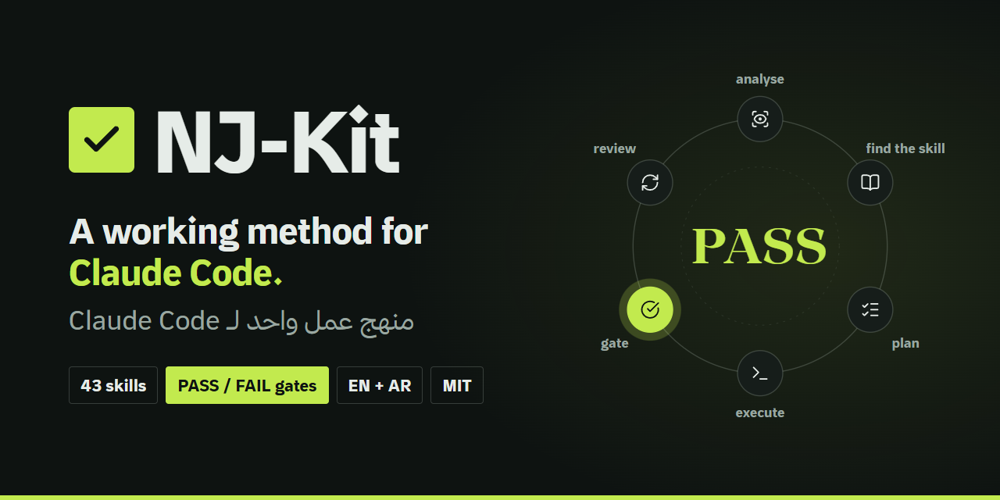

<div align="center">

<a href="https://nj-burrito.github.io/NJ-Kit/"></a>

# NJ-Kit

## A working method for Claude Code.

## Skills that check their own work.

[](https://nj-burrito.github.io/NJ-Kit/)
[](https://github.com/NJ-Burrito/NJ-Kit/actions/workflows/ci.yml)
[](LICENSE)
[](https://font.thmanyah.com)
[](.claude-plugin/marketplace.json)
[](#whats-inside)
[](nj-plugin/skills/arabic-english-proofreading)
[](nj-kit/scripts/install.py)
[](https://www.linkedin.com/in/nader-alzghoul)
[](https://github.com/NJ-Burrito)
[](https://nj-burrito.github.io/)
[](https://github.com/NJ-Burrito/NJ-Kit/stargazers)

> ### ⚡ In 10 seconds
> 🧠 **What:** a free toolkit that gives Claude Code one working method and 43 skills.\
> ✅ **Why:** every skill ends with a script that says **PASS** or **FAIL**. No "should work".\
> 🚀 **Start:** 2 lines in Claude Code. [Go ↓](#plugin)\
> 🌐 **Website:** [nj-burrito.github.io/NJ-Kit](https://nj-burrito.github.io/NJ-Kit/) in English and Arabic.

### Pick how you want it. All free. 👇

| 🧩 Plugin | 🧰 Kit installer | 📂 Copy a skill | 🔤 NJ-Font |
|:---:|:---:|:---:|:---:|
| For **Claude Code** | Whole setup on a new machine | For any agent that reads `SKILL.md` | A typeface by the creator |
| [Install ↓](#plugin) | [Install ↓](#kit) | [Browse ↓](#whats-inside) | [Install ↓](#nj-font) |

</div>

---

<a id="plugin"></a>

## 🧩 Plugin · ⏱️ 1 minute

**1.** In Claude Code, paste:

```
/plugin marketplace add NJ-Burrito/NJ-Kit
/plugin install nj-kit@nj-kit
```

**2.** Say: **"use nj-method"** ✅ Done. You have 23 skills.

---

<a id="kit"></a>

## 🧰 Kit installer · ⏱️ 5 minutes

Needs: 🐍 Python 3.10+

```bash
git clone https://github.com/NJ-Burrito/NJ-Kit
cd NJ-Kit
python nj-kit/scripts/install.py --check   # 👀 preview, changes nothing
python nj-kit/scripts/install.py           # ✅ install
```

<details>
<summary>📖 More: where skills go, options</summary>

- Skills land in `~/.claude/skills/` (every repo on this machine).
- `--scope project` puts them in one repo instead.
- [uv](https://docs.astral.sh/uv/) is recommended for Python.
- Full guide: [nj-kit/README.md](nj-kit/README.md)

</details>

---

## 🔁 How it works · 3 steps

<div align="center"></div>

| 1️⃣ Install | 2️⃣ Ask | 3️⃣ Read the gate |
|:---:|:---:|:---:|
| Plugin or kit | Ask for work as usual | ✅ PASS or ❌ FAIL, from a script |

---

<a id="whats-inside"></a>

## 📦 What's inside · tap a row to open

<details>
<summary>🧠 <b>Method and agents</b> · 9 skills · plan, delegate, hand off</summary>

| Skill | What it does |
|---|---|
| [nj-method](nj-plugin/skills/nj-method) | The default method for every request: analyse, find a skill, plan with checkpoints, execute, review |
| [nj-delegate](nj-plugin/skills/nj-delegate) | Governance for agent teams: a Lead decides, workers build, helpers do bounded work; every clause enforced |
| [nj-agent-ops](nj-plugin/skills/nj-agent-ops) | The transport layer: results through files, telemetry refused at write time (`relay.py`) |
| [nj-supervise](nj-plugin/skills/nj-supervise) | How to brief a worker and know it is actually working |
| [session-handoff](nj-plugin/skills/session-handoff) | Close a session with a `handoff.md` the next one reads first |
| [nj-learn](nj-plugin/skills/nj-learn) | Capture a lesson where it will be read again |
| [nj-wrapup](nj-plugin/skills/nj-wrapup) | Close a session or a tested service end to end, through gates |
| [devil](nj-plugin/skills/devil) | Ranked objections to a plan before you act on it |
| [nj-security-review](nj-plugin/skills/nj-security-review) | Audit third-party skills, plugins and MCP servers before installing |

</details>

<details>
<summary>✅ <b>QA and Jira</b> · 5 skills · tickets, Bugs, automation</summary>

| Skill | What it does |
|---|---|
| [nj-jira](nj-plugin/skills/nj-jira) | Analyse a ticket, file Bugs with evidence, QA re-check, keep a tracker |
| [nj-jira-to-automation](nj-plugin/skills/nj-jira-to-automation) | Turn a ticket into a runnable automation |
| [nj-qa-pipeline](nj-plugin/skills/nj-qa-pipeline) | Jira → notes → staging check → acceptance report → automation |
| [nj-automation-suite](nj-plugin/skills/nj-automation-suite) | Scaffold a portable, self-contained Playwright suite |
| [nj-rank](nj-plugin/skills/nj-rank) | Register finished work with its evidence and file it as Done |

</details>

<details>
<summary>📄 <b>Documents and writing</b> · 6 skills · PDFs, proofreading, diagrams</summary>

| Skill | What it does |
|---|---|
| [pdf-typography](nj-plugin/skills/pdf-typography) | PDFs whose text stays real: selectable, searchable, then audited |
| [arabic-english-proofreading](nj-plugin/skills/arabic-english-proofreading) | Hamza, taa marbuta, bidi characters, mixed numerals, Latin punctuation in Arabic |
| [workflow-diagram](nj-plugin/skills/workflow-diagram) | Workflow figures drawn from evidence, BPMN-correct |
| [nj-writer](nj-plugin/skills/nj-writer) | Narration and script words, Arabic or English |
| [impact-copy](nj-plugin/skills/impact-copy) | Impact-first, metric-driven copy |
| [website-fine-print](nj-plugin/skills/website-fine-print) | Pre-ship site audit: privacy, hygiene, policy pages |

</details>

<details>
<summary>🎬 <b>Audio and video</b> · 3 skills · voice, music, film</summary>

| Skill | What it does |
|---|---|
| [voice-clean](nj-plugin/skills/voice-clean) | Master a voiceover to broadcast loudness with ffmpeg only |
| [bg-music](nj-plugin/skills/bg-music) | Licence-cleared music beds and SFX, with credit lines |
| [nj-director](nj-plugin/skills/nj-director) | Plan the picture of a 30–90 s film: beat sheet, shots |

</details>

<details>
<summary>🧰 <b>Bundled with the kit</b> · 20 more · research, design, decks</summary>

nj-evidence · nj-knowledge-book · nj-researcher · nj-style-film · nj-motion-deck · nj-laya · nj-pinterest · srs-verifier · safe-delete · pdf-typography, plus third-party design skills (brandkit, design-taste-frontend, high-end-visual-design, minimalist-ui, redesign-existing-projects, hyperframes-studio, general-video) and graphify. Folder: [`nj-kit/bundled`](nj-kit/bundled) · Credits: [THIRD_PARTY.md](THIRD_PARTY.md)

</details>

---

<a id="nj-font"></a>

## 🔤 NJ-Font

A typeface by Nader Alzghoul, installed from this repo in one go.

<details>
<summary>🍎 macOS / 🐧 Linux</summary>

```bash
git clone https://github.com/NJ-Burrito/NJ-Kit
cd NJ-Kit
cp NJ-Font/ttf/*.ttf ~/Library/Fonts/                                                  # macOS
mkdir -p ~/.local/share/fonts && cp NJ-Font/ttf/*.ttf ~/.local/share/fonts/ && fc-cache -f   # Linux
```

</details>

<details>
<summary>🪟 Windows (no admin needed)</summary>

```powershell
git clone https://github.com/NJ-Burrito/NJ-Kit
cd NJ-Kit
$dir = "$env:LOCALAPPDATA\Microsoft\Windows\Fonts"; New-Item -ItemType Directory -Force $dir | Out-Null
Get-ChildItem NJ-Font\ttf\*.ttf | ForEach-Object {
  Copy-Item $_ $dir
  New-ItemProperty "HKCU:\Software\Microsoft\Windows NT\CurrentVersion\Fonts" -Name "$($_.BaseName) (TrueType)" -Value "$dir\$($_.Name)" -Force | Out-Null
}
```

</details>

<details>
<summary>🌐 Web</summary>

```css
@font-face { font-family: "NJ-Font"; src: url("NJ-Font/woff2/NJ-Font-Regular.woff2") format("woff2"); font-display: swap; }
```

</details>

Fonts land in your user font folder. Restart open apps to see them. More: [NJ-Font/README.md](NJ-Font/README.md)

---

## 🔒 Is it safe?

| | |
|---|---|
| 🔑 **No secrets** | Keys and URLs come from your environment or `~/.claude/secrets/` |
| 🗑️ **Safe deletes** | To the recycle bin, never `rm -rf` |
| 🧪 **Real gates** | A skill can't say PASS unless the check ran |
| 🛡️ **Guard hook** | Sub-agents can't read secret paths |

---

## ❓ Questions · tap to open

<details><summary>💸 Is it free?</summary>

Yes. MIT licence.
</details>

<details><summary>📂 Do I need all of it?</summary>

No. Copy one skill folder into `~/.claude/skills/` and it works on its own.
</details>

<details><summary>🌍 Arabic?</summary>

Yes. Arabic and English are both first-class, RTL included.
</details>

<details><summary>🗺️ Will paths work on my machine?</summary>

Yes. Nothing is tied to one machine. Set `NJ_PLUGIN_ROOT`, `JIRA_BASE_URL`, `PORTAL_URL` and the other variables a skill names, or keep the defaults under your home folder.
</details>

---

## Creator and contributors

| | Who | Contact |
|---|---|---|
| 🛠️ **Creator** | **Nader Alzghoul** ([@NJ-Burrito](https://github.com/NJ-Burrito)) | naderalzghoulbusiness@gmail.com · [Portfolio](https://nj-burrito.github.io/) · [LinkedIn](https://www.linkedin.com/in/nader-alzghoul) |

Want to be listed here? See [CONTRIBUTING.md](CONTRIBUTING.md).

<br>

[Contributing](CONTRIBUTING.md) · [Security](SECURITY.md) · [Changelog](CHANGELOG.md) · [Third-party credits](THIRD_PARTY.md)

Free and open source under the [MIT licence](LICENSE). Not affiliated with or endorsed by Anthropic.
