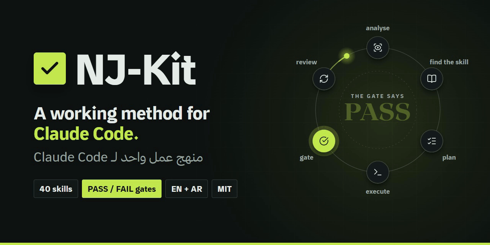
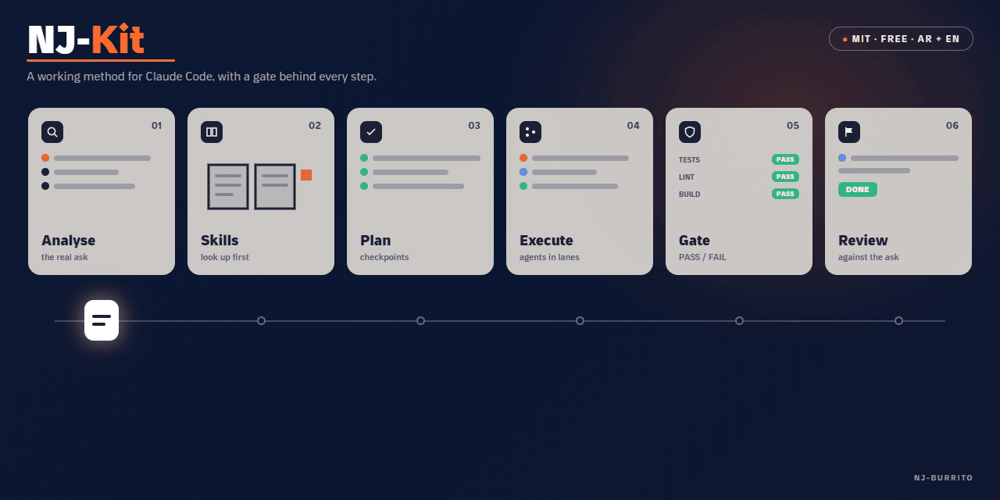

<div align="center">

<a href="https://nj-burrito.github.io/NJ-Kit/"></a>

# NJ-Kit: Claude Code skills that end in PASS or FAIL

### ✅ One working method and 41 skills for Claude Code. Every skill ends in a script that checks the work.

[](https://nj-burrito.github.io/NJ-Kit/)
[](https://github.com/NJ-Burrito/NJ-Kit/actions/workflows/ci.yml)
[](LICENSE)
[](#whats-inside)

<details>
<summary>🏷️ More badges</summary>

[](.claude-plugin/marketplace.json)
[](nj-plugin/skills/arabic-english-proofreading)
[](nj-kit/scripts/install.py)
[](https://font.thmanyah.com)
[](https://github.com/NJ-Burrito/NJ-Kit/stargazers)

</details>

</div>

> ### ⚡ In 10 seconds
> 🧠 **What:** a free method and 41 skills for Claude Code.\
> ✅ **Why:** a script prints **PASS** or **FAIL**. No "should work".\
> 🚀 **Start:** paste 2 lines into Claude Code. [Go ↓](#plugin)\
> 🌐 **Website:** [nj-burrito.github.io/NJ-Kit](https://nj-burrito.github.io/NJ-Kit/) · [بالعربية](https://nj-burrito.github.io/NJ-Kit/ar/)

🧭 **Jump to:** [Start here](#start-here) · [How it works](#how) · [Skills](#whats-inside) · [NJ-Narration](#narration) · [Compare](#compare) · [Safety](#safe) · [Questions](#faq) · [NJ-Font](#nj-font) · [العربية](#ar)

---

<a id="start-here"></a>

## 🚦 Start here · pick one row

| You want… | Take this | Time |
|---|---|---|
| 🧩 Claude Code, fastest | [Plugin ↓](#plugin) · 24 skills | ⏱️ 1 min |
| 🧰 All 41 on a new machine | [Kit installer ↓](#kit) | ⏱️ 5 min |
| 📂 Another agent that reads `SKILL.md` | [Copy one skill ↓](#whats-inside) | ⏱️ 1 folder |
| 🔤 The typeface | [NJ-Font ↓](#nj-font) | ⏱️ 1 command |

All free. 👆 Pick one and skip the rest.

---

<a id="how"></a>

## 🔁 How it works · 6 steps, 1 gate

<div align="center"></div>

| Step | What happens |
|---|---|
| 🔍 **1 Analyse** | Name the deliverable and what "done" means |
| 📖 **2 Find the skill** | Use a tested skill before improvising |
| 📋 **3 Plan** | Short steps, each leaving a checkpoint file |
| ⌨️ **4 Execute** | Do the work, checking as it goes |
| ✅ **5 Gate** | A script prints PASS or FAIL. FAIL: one fix, run again |
| 🔄 **6 Review** | Compare the result with the request, item by item |

---

<a id="plugin"></a>

## 🧩 Plugin · ⏱️ 1 minute

**1.** In Claude Code, paste:

```
/plugin marketplace add NJ-Burrito/NJ-Kit
/plugin install nj-kit@nj-kit
```

**2.** Say: **"use nj-method"** ✅ Done. You have 24 skills.

---

<a id="kit"></a>

## 🧰 Kit installer · ⏱️ 5 minutes

Needs: 🐍 Python 3.10+

```bash
git clone https://github.com/NJ-Burrito/NJ-Kit
cd NJ-Kit
python nj-kit/scripts/install.py --check       # 👀 preview, changes nothing
python nj-kit/scripts/install.py               # ✅ install
python nj-kit/scripts/fetch_assets.py --all    # 📦 download NJ-Kit assets v1
```

<details>
<summary>📖 More: where skills go, the assets, options</summary>

- 📍 Skills land in `~/.claude/skills/` (every repo on this machine).
- 🎯 `--scope project` puts them in one repo instead.
- 📦 **NJ-Kit assets v1** is a GitHub release (tag `assets-v1`).
- It holds the heavy parts kept out of git:
  - the graphify package
  - the nj-researcher source registry
  - the tashkeel evidence runs
- 🔐 `fetch_assets.py` checks each file's sha256 before writing it.
- 📋 `--list` shows them.
- ⚡ [uv](https://docs.astral.sh/uv/) is recommended for Python.
- 📖 Full guide: [nj-kit/README.md](nj-kit/README.md)

</details>

---

<a id="whats-inside"></a>

## 📦 41 Claude Code skills · tap a row to open

24 come with the plugin. The kit installer adds 17. Every one ends in a PASS or FAIL gate.

<details>
<summary>🧠 <b>Method and agents</b> · 9 skills · plan, delegate, hand off</summary>

| Skill | What it does |
|---|---|
| [nj-method](nj-plugin/skills/nj-method) | The default method for every request: analyse, find a skill, plan with checkpoints, execute, review |
| [nj-delegate](nj-plugin/skills/nj-delegate) | Governance for agent teams: a Lead decides, workers build, helpers do bounded work; every clause enforced |
| [nj-agent-ops](nj-plugin/skills/nj-agent-ops) | The transport layer: results through files, telemetry refused at write time (`relay.py`) |
| [nj-supervise](nj-plugin/skills/nj-supervise) | How to brief a worker and know it is actually working |
| [session-handoff](nj-plugin/skills/session-handoff) | Close a session with a `handoff.md` the next one reads first |
| [nj-learn](nj-plugin/skills/nj-learn) | Capture a lesson where it will be read again |
| [nj-wrapup](nj-plugin/skills/nj-wrapup) | Close a session or a tested service end to end, through gates |
| [devil](nj-plugin/skills/devil) | Ranked objections to a plan before you act on it |
| [nj-security-review](nj-plugin/skills/nj-security-review) | Audit third-party skills, plugins and MCP servers before installing |

</details>

<details>
<summary>✅ <b>QA and Jira</b> · 5 skills · tickets, Bugs, automation</summary>

| Skill | What it does |
|---|---|
| [nj-jira](nj-plugin/skills/nj-jira) | Analyse a ticket, file Bugs with evidence, QA re-check, keep a tracker |
| [nj-jira-to-automation](nj-plugin/skills/nj-jira-to-automation) | Turn a ticket into a runnable automation |
| [nj-qa-pipeline](nj-plugin/skills/nj-qa-pipeline) | Jira → notes → staging check → acceptance report → automation |
| [nj-automation-suite](nj-plugin/skills/nj-automation-suite) | Scaffold a portable, self-contained Playwright suite |
| [nj-rank](nj-plugin/skills/nj-rank) | Register finished work with its evidence and file it as Done |

</details>

<details>
<summary>📄 <b>Documents and writing</b> · 6 skills · PDFs, proofreading, diagrams</summary>

| Skill | What it does |
|---|---|
| [pdf-typography](nj-plugin/skills/pdf-typography) | PDFs whose text stays real: selectable, searchable, then audited |
| [arabic-english-proofreading](nj-plugin/skills/arabic-english-proofreading) | Hamza, taa marbuta, bidi characters, mixed numerals, Latin punctuation in Arabic |
| [workflow-diagram](nj-plugin/skills/workflow-diagram) | Workflow figures drawn from evidence, BPMN-correct |
| [nj-writer](nj-plugin/skills/nj-writer) | Narration and script words, Arabic or English |
| [impact-copy](nj-plugin/skills/impact-copy) | Impact-first, metric-driven copy |
| [website-fine-print](nj-plugin/skills/website-fine-print) | Pre-ship site audit: privacy, hygiene, policy pages |

</details>

<details>
<summary>🎬 <b>Audio and video</b> · 4 skills · voice, music, film</summary>

| Skill | What it does |
|---|---|
| [voice-clean](nj-plugin/skills/voice-clean) | Master a voiceover to broadcast loudness with ffmpeg only |
| [nj-narration](nj-plugin/skills/nj-narration) | Cast and engineer a TTS voice, then clean the noise around each line |
| [bg-music](nj-plugin/skills/bg-music) | Licence-cleared music beds and SFX, with credit lines |
| [nj-director](nj-plugin/skills/nj-director) | Plan the picture of a 30–90 s film: beat sheet, shots |

</details>

<details>
<summary>🧰 <b>Bundled with the kit</b> · 17 more · research, design, decks</summary>

| Group | Skills |
|---|---|
| 🔬 By NJ · 9 | nj-evidence · nj-knowledge-book · nj-researcher · nj-style-film · nj-motion-deck · nj-laya · nj-pinterest · srs-verifier · safe-delete |
| 🎨 Third-party design · 7 | brandkit · design-taste-frontend · high-end-visual-design · minimalist-ui · redesign-existing-projects · hyperframes-studio · general-video |
| 🕸️ Third-party graph · 1 | graphify |

- 🧰 The kit installer puts them in place.
- 📦 Heavy parts come from **NJ-Kit assets v1**: `python nj-kit/scripts/fetch_assets.py --all`
- 📁 Folder: [`nj-kit/bundled`](nj-kit/bundled) · 🙏 Credits: [THIRD_PARTY.md](THIRD_PARTY.md)

</details>

---

<a id="compare"></a>

## 🆚 NJ-Kit and other Claude Code skill collections

You can combine them. NJ-Kit skills are plain `SKILL.md` folders, so they work next to skills from any of these.

| Project | What it is | Reach for it when |
|---|---|---|
| ✅ **NJ-Kit** | A working method and 41 skills. Every skill ends in a PASS or FAIL script. Arabic and English | You want the agent to prove a task is done |
| [anthropics/skills](https://github.com/anthropics/skills) | Anthropic's public repository for Agent Skills | You want the skills Anthropic publishes itself |
| [obra/superpowers](https://github.com/obra/superpowers) | An agentic skills framework and software development methodology | You want a software development methodology built from skills |
| [awesome-claude-code](https://github.com/hesreallyhim/awesome-claude-code) | A hand-picked list of Claude Code resources: skills, agents, plugins, tools | You want to browse what exists |

Descriptions from each project's own GitHub page, 24 Oct 2026.

---

<a id="nj-font"></a>

## 🔤 NJ-Font

A typeface by Nader Alzghoul, installed from this repo in one go.

<details>
<summary>🍎 macOS / 🐧 Linux</summary>

```bash
git clone https://github.com/NJ-Burrito/NJ-Kit
cd NJ-Kit
cp NJ-Font/ttf/*.ttf ~/Library/Fonts/                                                  # macOS
mkdir -p ~/.local/share/fonts && cp NJ-Font/ttf/*.ttf ~/.local/share/fonts/ && fc-cache -f   # Linux
```

</details>

<details>
<summary>🪟 Windows (no admin needed)</summary>

```powershell
git clone https://github.com/NJ-Burrito/NJ-Kit
cd NJ-Kit
$dir = "$env:LOCALAPPDATA\Microsoft\Windows\Fonts"; New-Item -ItemType Directory -Force $dir | Out-Null
Get-ChildItem NJ-Font\ttf\*.ttf | ForEach-Object {
  Copy-Item $_ $dir
  New-ItemProperty "HKCU:\Software\Microsoft\Windows NT\CurrentVersion\Fonts" -Name "$($_.BaseName) (TrueType)" -Value "$dir\$($_.Name)" -Force | Out-Null
}
```

</details>

<details>
<summary>🌐 Web</summary>

```css
@font-face { font-family: "NJ-Font"; src: url("NJ-Font/woff2/NJ-Font-Regular.woff2") format("woff2"); font-display: swap; }
```

</details>

- 📁 Fonts land in your user font folder.
- 🔄 Restart open apps to see them.
- 📖 More: [NJ-Font/README.md](NJ-Font/README.md)

---

<a id="safe"></a>

## 🔒 Is it safe?

| | |
|---|---|
| 🔑 **No secrets** | Keys and URLs come from your environment or `~/.claude/secrets/` |
| 🗑️ **Safe deletes** | To the recycle bin, never `rm -rf` |
| 🧪 **Real gates** | A skill can't say PASS unless the check ran |
| 🛡️ **Guard hook** | Sub-agents can't read secret paths |

---

<a id="faq"></a>

## ❓ Questions about NJ-Kit and Claude Code skills · tap to open

<details><summary>🧠 What is NJ-Kit?</summary>

A free, open-source Claude Code plugin: one working method and 41 skills. Every skill ends in a script gate that prints PASS or FAIL. MIT licence, by Nader Alzghoul.
</details>

<details><summary>📂 What are Claude Code skills?</summary>

A skill is a folder with a `SKILL.md` file of instructions, plus any scripts it needs. Claude Code reads each skill's description and loads the skill when a task matches it.
</details>

<details><summary>✅ What is a gate?</summary>

A script at the end of a skill that checks the result and prints PASS or FAIL. On FAIL, the skill makes one fix and runs the gate again.
</details>

<details><summary>🆚 How is it different from Anthropic's skills repository?</summary>

Anthropic's repository is its public collection of Agent Skills. NJ-Kit is an independent kit built around one working method, and every one of its skills ends in a PASS or FAIL script. You can install both. [Compare ↑](#compare)
</details>

<details><summary>🤖 Does it work with agents other than Claude Code?</summary>

Any agent that reads `SKILL.md` files can use the skill folders directly, with no installer. The plugin route is for Claude Code.
</details>

<details><summary>🏢 Is NJ-Kit made by Anthropic?</summary>

No. An independent project by Nader Alzghoul, not affiliated with or endorsed by Anthropic.
</details>

<details><summary>💸 Is it free?</summary>

Yes. MIT licence.
</details>

<details><summary>📂 Do I need all of it?</summary>

No. Copy one skill folder into `~/.claude/skills/` and it works on its own.
</details>

<details><summary>🌍 Arabic?</summary>

Yes. Arabic and English are both first-class, RTL included.
</details>

<details><summary>🗺️ Will paths work on my machine?</summary>

Yes. Nothing is tied to one machine.

- ⚙️ Set the variables a skill names: `NJ_PLUGIN_ROOT`, `JIRA_BASE_URL`, `PORTAL_URL`…
- 🏠 Or keep the defaults under your home folder.
</details>

---

<a id="narration"></a>

## 🎙️ NJ-Narration · the right voice, no noise around it

> **In the plugin since 2.0.2.** A skill that picks and cleans a narrator's voice, and prints PASS or FAIL for every step.

- 🎯 **Scout a voice that fits the character.** Describe age, origin, accent and mood; the skill turns it into numbers and measures licensed voices against them.
- 🛠️ **Engineer it once, at the source.** The reference clip is cleaned once and every line is voiced once. No re-voicing until one sounds right.
- 🩹 **Heal noise without cutting words.** Hiss before or after a sentence is removed, and a gate checks the speech itself is untouched.

**One example** (made-up data, to show the shape of the output; not a real measurement, not a real person):

```text
BRIEF    narrator, woman, 40 to 55, calm, British English, dry room
TARGET   pitch 165 to 210 Hz, 130 to 150 words a minute, little echo
SOURCES  public domain or written consent only, one clip per speaker

REFERENCE CLIP (the one you will clone)
REF-QUALITY       FAIL  0.6 s of room tone at the start
                  # cleaned once, word-safe, then measured again
REF-QUALITY       PASS

EACH GENERATED LINE (one take)
TAKE-QUALITY      PASS
VOICE-EDGE-NOISE  FAIL  1.9 s of hiss after the last word
                  # cleaned without touching the speech
VOICE-EDGE-NOISE  PASS  speech samples identical

NEXT     the top 3 voices go to your ear. You decide.
```

**Install:** the same two lines as NJ-Kit ([Plugin ↑](#plugin)). `nj-narration` is one of the 24 plugin skills; after installing, say **"use nj-narration"**.

Plugin only: `/plugin install nj-kit@nj-kit`. Any other agent that reads `SKILL.md`: copy the folder [`nj-plugin/skills/nj-narration`](nj-plugin/skills/nj-narration).

**Honest note:** NJ-Narration ships no voices and no audio samples. It includes no voice engine and picks none for you: you bring a licensed voice and an engine you are allowed to use. The numbers decide what reaches your ear; your ear decides last.

---

## 🔗 More from NJ

| | |
|---|---|
| 👤 [**Portfolio**](https://nj-burrito.github.io/) | Nader's work |
| 🧪 [**QA Wrap**](https://nj-burrito.github.io/QA-Wrap/) | Test the page, get the bug report. [Source](https://github.com/NJ-Burrito/QA-Wrap) |
| 📄 [**Business-Wrap**](https://nj-burrito.github.io/Business-Wrap/) | Evidence in, one document in two languages. [Source](https://github.com/NJ-Burrito/Business-Wrap) |
| 🧾 [**Profile-Wrap**](https://nj-burrito.github.io/Profile-Wrap/) | Your LinkedIn on autopilot, you stay the boss. [Source](https://github.com/NJ-Burrito/Profile-Wrap) |
| 🎬 [**Story-Wrap**](https://www.instagram.com/nj.story.ar/) | The series «مكتب المفقودات» |
| 🐙 [**GitHub**](https://github.com/NJ-Burrito) · 💼 [**LinkedIn**](https://www.linkedin.com/in/nader-alzghoul) · ✉️ [**Contact**](https://nj-burrito.github.io/#contact) | |
| 🌐 **This kit's website** | [English](https://nj-burrito.github.io/NJ-Kit/) · [Arabic](https://nj-burrito.github.io/NJ-Kit/ar/) |

---

<a id="ar"></a>

## 🌍 بالعربية

<div dir="rtl" lang="ar">

**NJ-Kit** منهج عمل مجاني و41 مهارة لـ Claude Code. تنتهي كل مهارة بسكربت يفحص النتيجة ويطبع PASS أو FAIL، فتعني «تم» أن فحصًا جرى فعلًا.

- 🚀 **ابدأ:** الصق السطرين في Claude Code، فتحصل على 24 مهارة في نحو دقيقة. [السطران ↑](#plugin)
- 🧰 **الحزمة كاملة:** يضيف مثبّت الحزمة الـ17 الباقية. [المثبّت ↑](#kit)
- 📂 **أي وكيل:** يقرأ ملفات `SKILL.md`؟ انسخ مجلد مهارة واحدة، بلا مثبّت.
- 🌍 **العربية والإنجليزية** بالمستوى نفسه، مع دعم الكتابة من اليمين إلى اليسار ومدقق لغوي للنص العربي.
- 🎙️ **NJ-Narration** (ضمن الإضافة، `nj-narration`): مهارة تختار صوت الراوي المناسب للشخصية، وتهندسه مرة واحدة من المصدر، وتعالج الضجيج قبل الجملة وبعدها دون قصّ الكلمات. لا تأتي بأي أصوات ولا بعينات صوتية. [مثال بالنص ↑](#narration)
- 💸 **مجانية** ومفتوحة المصدر برخصة MIT، وغير تابعة لشركة Anthropic ولا معتمدة منها.
- 🌐 **الموقع بالعربية:** [nj-burrito.github.io/NJ-Kit/ar](https://nj-burrito.github.io/NJ-Kit/ar/)

</div>

---

## 👋 Creator and contributors

| | Who | Contact |
|---|---|---|
| 🛠️ **Creator** | **Nader Alzghoul** ([@NJ-Burrito](https://github.com/NJ-Burrito)) | naderalzghoulbusiness@gmail.com · [Portfolio](https://nj-burrito.github.io/) · [LinkedIn](https://www.linkedin.com/in/nader-alzghoul) |

Want to be listed here? See [CONTRIBUTING.md](CONTRIBUTING.md).

<br>

[Contributing](CONTRIBUTING.md) · [Security](SECURITY.md) · [Changelog](CHANGELOG.md) · [Third-party credits](THIRD_PARTY.md)

Free and open source under the [MIT licence](LICENSE). Not affiliated with or endorsed by Anthropic.
